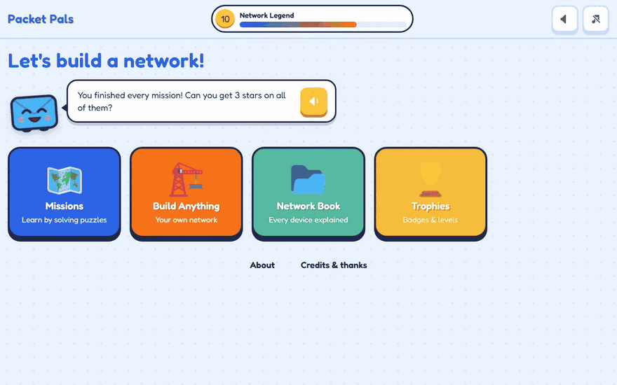
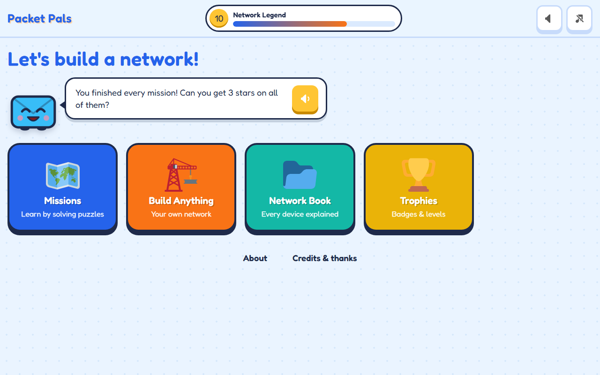
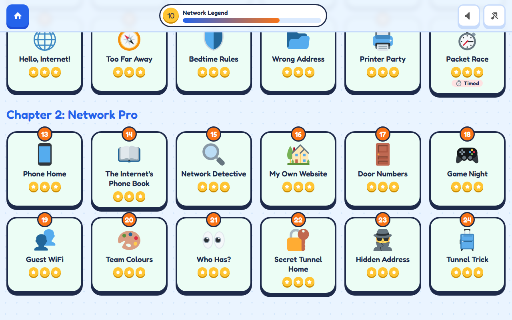
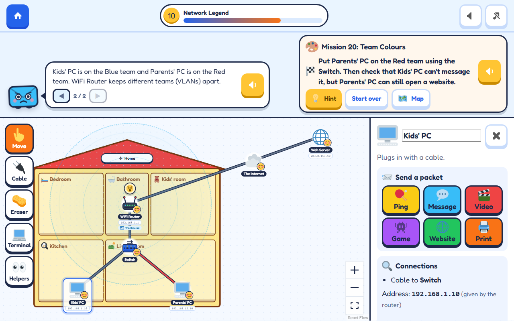
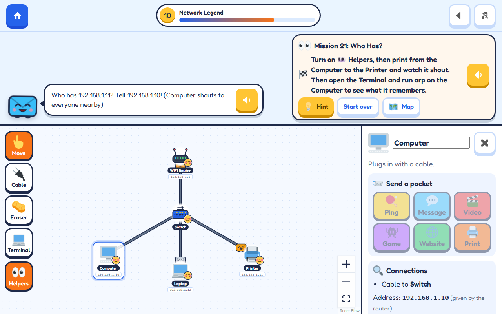
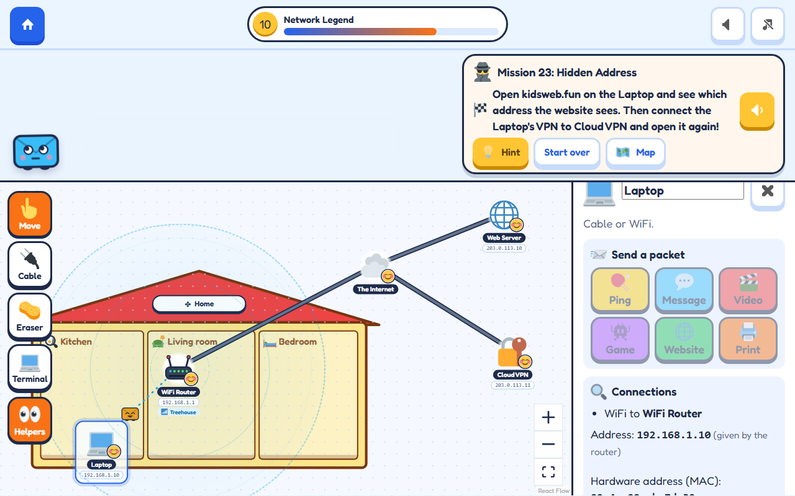
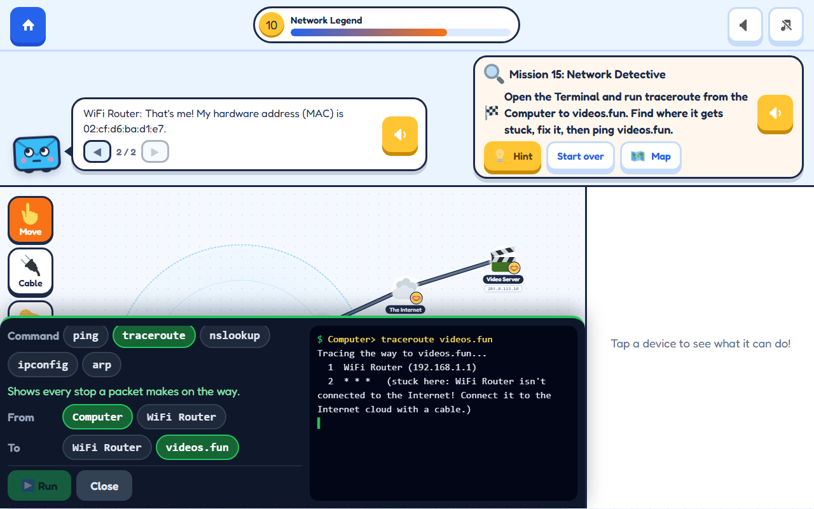

<div align="center">


# Packet Pals

**Build networks with computers, WiFi, routers and firewalls, then watch Pip the Packet zoom along the wires. Real networking, made for kids.**

[](https://github.com/Troy-Story-Games/packet-pals/releases/latest)
[](https://github.com/Troy-Story-Games/packet-pals/actions/workflows/pages.yml)
[](https://github.com/Troy-Story-Games/packet-pals/releases)
[](LICENSE)
<br>


[**▶ Play now**](https://troy-story-games.github.io/packet-pals/) · [**Download**](#download) · [**Features**](#features) · [**Screenshots**](#screenshots) · [**Build from source**](#build-from-source)

<br>



<sub>30-second tour · <a href="docs/demo.mp4">watch as video (MP4)</a></sub>

</div>

## Why

Packet Pals was made for a 7-year-old who loves WiFi, routers and anything with blinking lights. It's like a drawing app for networks: drag in devices, plug in cables, then send a packet and watch exactly where it goes and why. Every idea is a real one (switches, DHCP, DNS, firewalls, VLANs, VPNs), explained in words a young reader can follow, with read-aloud for everything.

- **Learn by doing**: 24 story missions, each teaching one networking idea
- **See the invisible**: every packet hop is animated and explained
- **Gamified**: XP, levels, stars, badges, streaks and a device collection book
- **Works anywhere**: tablets, Chromebooks, phones, and as a desktop app, online or offline

## Download

Play in the browser at **[troy-story-games.github.io/packet-pals](https://troy-story-games.github.io/packet-pals/)**. On a tablet or Chromebook, tap **Install app** on the home screen to add it like a real app (it works offline too).

Desktop apps are on the [Releases page](https://github.com/Troy-Story-Games/packet-pals/releases/latest):

| System | File |
| --- | --- |
| Windows | `packet-pals-<version>-windows-setup.exe` (installer) or `packet-pals-<version>-windows-portable.exe` (no install) |
| macOS | `packet-pals-<version>-mac-arm64.dmg` (Apple Silicon) or `packet-pals-<version>-mac-x64.dmg` (Intel) |
| Linux | `packet-pals-<version>-linux-x86_64.AppImage` |

> The apps aren't code-signed. On **Windows**, click *More info* → *Run anyway* if SmartScreen appears. On **macOS**, right-click the app → *Open* the first time. On **Linux**, make the AppImage executable (`chmod +x`). Progress is saved on the device; nothing is sent anywhere.

## Features

### 🧩 Missions
- **Chapter 1: Network Basics** (12 missions): cables, ping, hubs vs switches, routers and DHCP, WiFi names and passwords, the Internet, firewalls, addresses, printers, and a timed build-from-scratch race
- **Chapter 2: Network Pro** (12 missions): phones and cell towers, DNS servers and your own website names, the Terminal with traceroute, firewall "doors" (port forwarding) for friends and game nights, Guest WiFi, VLAN team colours, ARP "who has?" shouts, and VPN tunnels (reach home from Grandma's, hide your address, sneak past a firewall)
- Advanced settings unlock only after the mission that teaches them, with gentle nudges when you're close

### 🛠️ Sandbox
- Drag-and-drop canvas with computers, laptops, tablets, phones, consoles, printers, hubs, switches, routers, firewalls, cell towers, servers, DNS and VPN servers, plus smart-home gadgets
- Houses and offices with rooms and paintable colours to build in
- Autosave, save/open files, and share a network as a QR code link

### 📦 Packets you can watch
- Ping, message, video, game, website and print, animated hop by hop
- Hubs flood, switches forward, routers translate addresses, firewalls say NO, and VPN packets ride inside a glowing tunnel
- Pip explains every step; page back through the messages or have them read aloud
- A pill-built **Terminal** for `ping`, `traceroute`, `nslookup`, `ipconfig` and `arp`

## Screenshots

| | |
| --- | --- |
|  |  |
|  |  |
|  |  |

## Build from source

Requires [Node.js](https://nodejs.org/) 24 (see `.nvmrc`).

```bash
git clone https://github.com/Troy-Story-Games/packet-pals.git
cd packet-pals
npm install
npm run dev          # http://localhost:5173
```

| Command | What it does |
| --- | --- |
| `npm test` | Unit tests (Vitest): the network simulator and every mission |
| `npm run test:e2e` | End-to-end tests in tablet and phone viewports (Playwright; run `npx playwright install chromium` once first) |
| `npm run lint` | ESLint |
| `npm run build` | Type-check and build the static site into `dist/` |
| `npm run preview` | Serve the production build locally |
| `npm run electron:dev` | Run the desktop app against the dev server |
| `npm run electron:build` | Build a desktop app for your OS into `release/` |
| `npm run icons` | Regenerate the app icons |

To try it on a tablet on the same network, run `npm run dev -- --host` and open the printed network URL.

### How it's built

React 19, TypeScript, Vite, React Flow, Zustand and Motion, with a framework-free network simulator in `src/core/sim`. It's a PWA for the web and uses Electron for desktop. There's no backend: everything runs and saves on the device.

```
src/
  app/          App shell: routing, top bar, reward pop-ups
  components/   Reusable UI (buttons, Pip the mascot, device art)
  core/sim/     Network simulator: devices, topology, addressing, packet journeys
  features/     One folder per screen (editor, missions, sandbox, book, about, ...)
  game/         XP, levels, badges, missions and unlocks
  services/     Audio, speech, install prompt, storage
electron/       Desktop app entry point
tests/          unit/ (Vitest) and e2e/ (Playwright)
```

## Made by TroyStoryGames

Made with ❤️ by **[TroyStoryGames](https://troystorygames.com)**. Also try **[QR Quest](https://github.com/Troy-Story-Games/qr-quest)**, which makes and explains QR codes.

Art and sounds come from CC0 and openly licensed sources (Kenney, Twemoji and others). See [CREDITS.md](CREDITS.md).

## License

[MIT](LICENSE)
